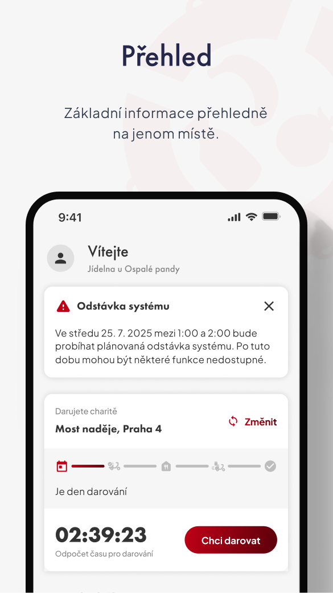
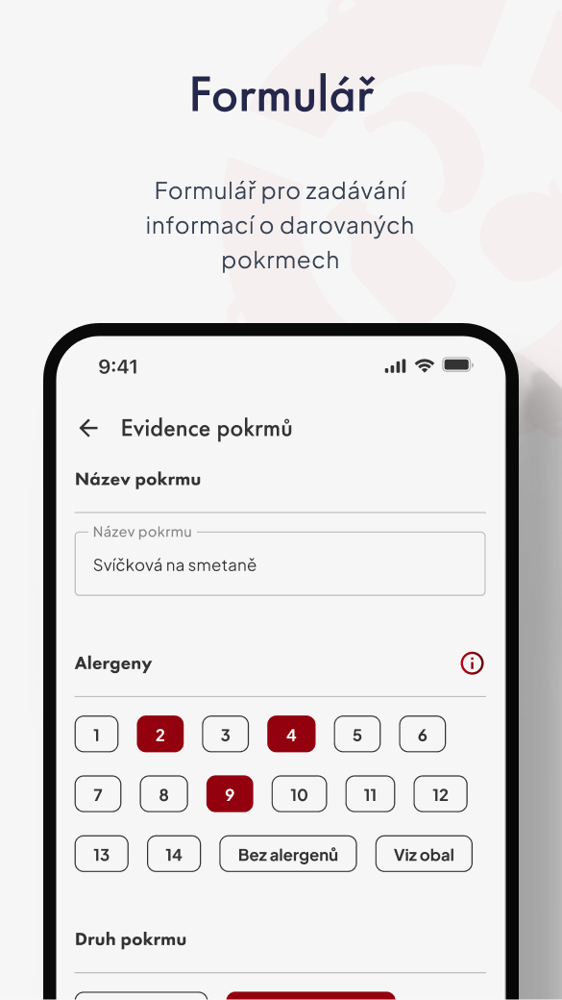
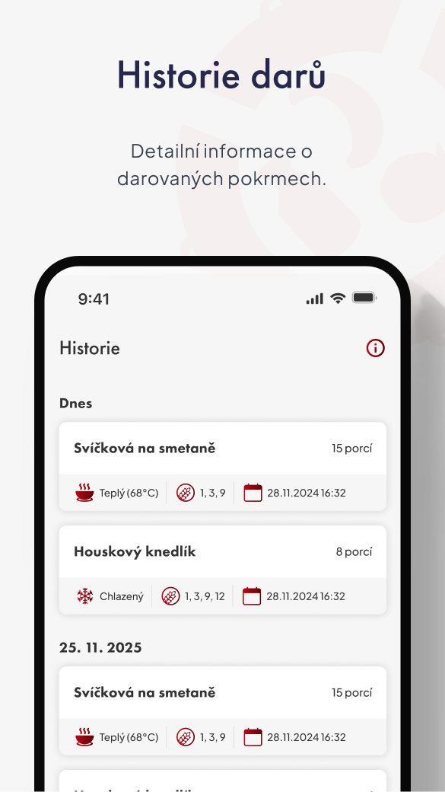
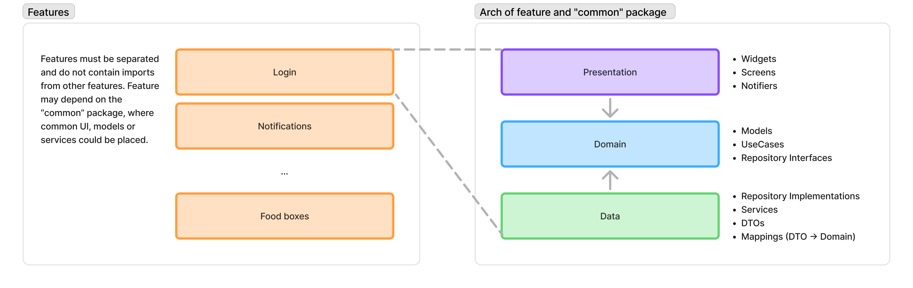

# Zachraň oběd

## 📝 Description

Zachraň oběd is a non-profit platform that connects canteens, restaurants and other food providers with charities and
shelters to donate surplus cooked meals that would otherwise go to waste.

The goal is to prevent food waste by redistributing safe, freshly prepared meals to people in need. The platform ensures
compliance with hygiene and legal standards and supports both public institutions (like school cafeterias or hospitals)
and private donors.

Key Highlights:

♻️ Rescues cooked meals that are safe to eat.

🏥 Works with schools, hospitals, corporate and public canteens.

🤝 Meals are picked up by recipient organizations or delivered by partners like DODO.

📱 Available as a mobile app (Android and iOS) and web platform.

💡 Over 50 000 meals saved across the Czech Republic.

Learn more at https://zachranobed.cz.

## 📸 Screenshots

<p>
  
  
  
</p>

## ✔️ Features

- ✅ Firebase Authentication (email/password).
- ✅ Firestore for donations, pickups and food box tracking.
- ✅ Delivery orders through the DODO courier service.
- ✅ Push notifications via Firebase Cloud Messaging.
- ✅ Firebase Cloud Functions for deliveries, notifications, box transfers and reports.
- ✅ Crash reporting and analytics via Firebase Crashlytics and Analytics.
- ✅ Force update, "What's new" and offline screens.
- ✅ Localized UI via Flutter's localization tooling.
- ✅ Multi-platform support: Android, iOS and Web.

## 🚀 Getting Started

Run `flutter` and `dart` through [FVM](https://fvm.app) so they use the SDK version pinned in `.fvmrc`. A global SDK
may be older and report false errors, for example in `dart analyze`.

```bash
# Install dependencies
fvm flutter pub get
fvm dart pub get --directory lint/arch   # Architecture lint plugin, a separate package

# Generate code (freezed, json_serializable, auto_route) and localizations
fvm flutter pub run build_runner build --delete-conflicting-outputs
fvm flutter gen-l10n

# Run the app
fvm flutter run --flavor dev --target lib/main_dev.dart
```

Run `build_runner` again after you change any file with `@freezed`, `@JsonSerializable` or route annotations.

### Flavors

The app has three flavors. Each one uses its own Firebase project and entry point.

| Flavor  | Entry point           | Firebase config                                  |
|---------|-----------------------|--------------------------------------------------|
| `dev`   | `lib/main_dev.dart`   | `lib/app/data/firebase/firebase_options_dev.dart`   |
| `stage` | `lib/main_stage.dart` | `lib/app/data/firebase/firebase_options_stage.dart` |
| `prod`  | `lib/main_prod.dart`  | `lib/app/data/firebase/firebase_options_prod.dart`  |

## 🗂️ Project Structure

```
├── lib/                        # App code (see Architecture below)
├── lint/arch/                  # Custom architecture lint rules
├── android/                    # Android project
├── ios/                        # iOS project
├── web/                        # Web project
├── functions/                  # Firebase Cloud Functions (TypeScript, Node.js)
├── cron/scripts/               # Scheduled scripts (monthly delivery report)
├── scripts/                    # Helper scripts for CI and local development
├── test/                       # Unit and widget tests
├── maestro/                    # End-to-end UI tests (Maestro)
├── docs/                       # Documentation images
├── firestore.rules             # Firestore security rules
├── .github/                    # GitHub Actions for CI/CD
└── pubspec.yaml                # Flutter metadata and dependencies
```

## 📦 Key Dependencies

Listed in `pubspec.yaml`:

- `firebase_core`, `firebase_auth`, `cloud_firestore`, `cloud_functions` – Firebase backend
- `firebase_messaging` & `flutter_local_notifications` – Push and local notifications
- `firebase_crashlytics` & `firebase_analytics` – Crash reporting and analytics
- `provider` – State management with `ChangeNotifier`
- `get_it` – Dependency injection
- `auto_route` – Routing
- `freezed` & `json_serializable` – Immutable models and JSON mapping (code generation)
- `intl` & `flutter_localizations` – Localization support

## 🏛️ Architecture

This project follows a **feature-based architecture** combined with **Clean Architecture principles** inside each
feature. The goal is to keep the codebase modular, testable, and scalable.

### 📂 Directory Structure

```
lib/
├── app/                   # Application wide components
│   ├── data/              # Firebase setup, logger
│   ├── presentation/      # Root widget, home and overview screens
│   └── di/                # Application dependency injection setup
│
├── features/              # Features directory
│   └── <feature_name>/    # Each feature is isolated
│       ├── domain/        # Models, repositories (interfaces), use cases
│       ├── data/          # Repository implementations, services, DTOs, mappers
│       ├── presentation/  # UI layer (screens, widgets, state management)
│       └── di/            # Dependency injection setup for this feature
│
├── common/                # Shared components
│   ├── domain/            # Shared models, repositories (interfaces), use cases
│   ├── data/              # Shared repository implementations, services, DTOs, mappers
│   ├── presentation/      # Shared UI widgets, styles, colors, router
│   └── di/                # Injection setup for common components
│
├── l10n/                  # Localization (app_cs.arb)
├── main_base.dart         # Shared app startup
└── main_<flavor>.dart     # Entry point for each flavor
```



### Lint Rules

A custom lint plugin in `lint/arch/` enforces the architecture:

- Only absolute imports (`package:zachranobed/...`).
- Features must not import other features. They can only import from `common`.
- Layers depend in one direction only: presentation → domain → data.
- Presentation must not access the data layer directly.

## 🧪 Testing

Unit and widget tests live in `test/` and run with the Flutter test runner:

```bash
fvm flutter test
```

Check the code the same way CI does. `flutter analyze` skips the `lint/arch` rules, so use `dart analyze`:

```bash
fvm dart analyze --fatal-infos
```

End-to-end UI tests live in `maestro/` and drive the real app against the dev Firebase backend. See the
[Maestro test guide](maestro/README.md) for how to install Maestro, run the flows and write new ones.

## 🛠 CI/CD (GitHub Actions)

- **Pull requests** run a debug Android build, a formatting check, `dart analyze --fatal-infos` and the Flutter tests.
- **Builds** for Android, iOS and Web exist for each flavor (`dev`, `stage`, `prod`, plus `rc` for iOS). They are
  started manually. Mobile builds go to Firebase App Distribution. Web builds deploy the web app.
- **Monthly report** (`create_report.yml`) runs `cron/scripts/create-delivery-report.js` on the first day of each month.

Secrets such as Firebase tokens are stored in **GitHub Secrets**.

## 🔥 Cloud Functions

The `functions/` directory holds the Firebase Cloud Functions written in TypeScript. See
[functions/README.md](functions/README.md) for how to move Firestore indexes from DEV to other environments.

```bash
cd functions
npm install
npm run build
npm run deploy
```

## 📞 Contact & Acknowledgements

**Maintainers**: [zachran-jidlo](https://github.com/zachran-jidlo)  
**Repo**: [github.com/zachran-jidlo/zachranobed](https://github.com/zachran-jidlo/zachranobed)  
**Changelog**: [CHANGELOG.md](CHANGELOG.md)

Built with 💙 using [Flutter](https://flutter.dev) and [Firebase](https://firebase.google.com).
